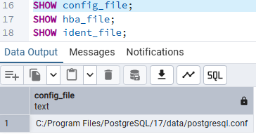
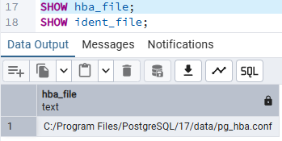
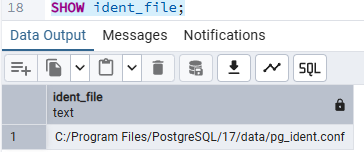
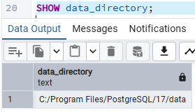
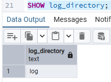
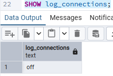
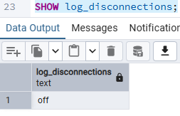

# Rutas de archivos de configuración – PostgreSQL 17

Rutas obtenidas con `SHOW config_file;`, `SHOW hba_file;` y `SHOW ident_file;`.

## Resumen

| Archivo | Comando | Ruta |
| --- | --- | --- |
| Configuración principal | `SHOW config_file;` | `C:/Program Files/PostgreSQL/17/data/postgresql.conf` |
| Autenticación de clientes (HBA) | `SHOW hba_file;` | `C:/Program Files/PostgreSQL/17/data/pg_hba.conf` |
| Mapeo de identidades | `SHOW ident_file;` | `C:/Program Files/PostgreSQL/17/data/pg_ident.conf` |

## Descripción y relevancia para el hardening

### `postgresql.conf`

Archivo de configuración principal del servidor. Aquí se definen los parámetros revisados en la superficie de ataque:

- `port`
- `listen_addresses`
- `ssl`
- `password_encryption`

### `pg_hba.conf`

Controla **quién puede conectarse, desde dónde, a qué base de datos y con qué método de autenticación**. Es el archivo clave para restringir conexiones remotas y exigir `scram-sha-256`. Su estado efectivo puede consultarse con:

### `pg_ident.conf`

Define el mapeo entre usuarios del sistema operativo (o de un método de autenticación externo) y roles de PostgreSQL. Solo se usa cuando `pg_hba.conf` emplea el método `peer`, `ident`, `gss`, `sspi` o similares con la opción `map=`.

## Observaciones

- Los tres archivos están en el mismo directorio de datos: `C:/Program Files/PostgreSQL/17/data/`.
- El directorio de datos debe tener permisos restringidos (solo la cuenta de servicio de PostgreSQL y administradores), ya que `pg_hba.conf` y `postgresql.conf` determinan la seguridad del servidor.
- Antes de modificar cualquiera de estos archivos conviene **hacer una copia de respaldo**.
- Los cambios en `postgresql.conf` y `pg_hba.conf` se aplican con `SELECT pg_reload_conf();`, salvo `listen_addresses` y `port`, que requieren **reinicio** del servicio. El parámetro `ssl` sí admite recarga.

## Pregunta

¿Por qué es importante conocer la ubicación física de estos archivos?
En primer lugar, saber dónde están permite proteger lo crítico. El directorio de datos guarda el contenido completo de las bases de datos y los archivos postgresql.conf y pg_hba.conf. Cualquiera con acceso de lectura o escritura al disco podría copiar datos, leer configuraciones o alterar las reglas de autenticación sin pasar por PostgreSQL, por lo que es necesario restringir los permisos únicamente a la cuenta de servicio y a los administradores.
