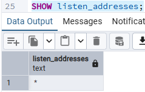

# PostgreSQL 17 - Interfaces de escucha

PostgreSQL está escuchando en todas las interfaces.

## Determinación

`SHOW listen_addresses;` → `*`

PostgreSQL está escuchando **en todas las interfaces**.

## Documentación

**Configuración encontrada:**
`listen_addresses = '*'` (puerto 5432). Acepta conexiones TCP/IP por cualquier interfaz del equipo.

**Interfaces necesarias:**

- `localhost` (`127.0.0.1` / `::1`) para administración local.
- Interfaz de la red privada interna usada por clientes legítimos (se observaron conexiones desde `172.18.0.5`).

**Interfaces innecesarias:**

- Interfaces públicas o de redes no confiables.
- Adaptadores sin clientes (VPN o virtualización sin uso).

## Riesgo

**Alto.** Con `*` el servicio queda expuesto en toda interfaz y la única barrera es `pg_hba.conf` y el firewall. Junto con `ssl = off`, las credenciales podrían viajar en texto claro.

Análisis

Considera el siguiente escenario:

Internet
   |
Firewall
   |
Servidor PostgreSQL
   |
5432

Ahora compáralo con:

Internet
   X
   |
Firewall
   |
Red privada
   |
Servidor PostgreSQL

## Arquitectura que reduce mejor la exposición

**La segunda arquitectura** (Internet bloqueado, red privada, servidor PostgreSQL).

### Por qué

1. **Elimina la exposición en lugar de filtrarla.** En el escenario 1 el servicio es accesible y se confía en que el firewall lo filtre bien. En el escenario 2 el servidor ni siquiera es enrutable desde Internet, por lo que no puede ser escaneado ni atacado directamente.

2. **Aplica defensa en profundidad.** Un error en una capa (por ejemplo, una regla permisiva en el firewall o en `pg_hba.conf`) no basta para comprometer el servicio, porque aún quedaría la barrera del aislamiento de red.

3. **Reduce el número de atacantes posibles.** Pasa de "cualquier host de Internet" a "solo equipos de la red privada", lo que disminuye la probabilidad de fuerza bruta, explotación de vulnerabilidades y filtración de credenciales.

4. **Compensa debilidades actuales.** Con `ssl = off` y `listen_addresses = *`, el escenario 1 enviaría credenciales en texto claro por una red no confiable. En una red privada ese riesgo se reduce considerablemente (aunque SSL sigue siendo recomendable).

5. **Facilita el control de acceso.** El acceso externo, cuando se necesita, se da por canales controlados (VPN, bastión o aplicación intermedia) y no abriendo el puerto de la base de datos.

## Relación con esta instalación

Esta configuración se parece más al escenario 1 que al 2: `listen_addresses = '*'` hace que el servicio escuche en toda interfaz, incluidas las públicas si existen. Para acercarse al escenario 2:

- Restringir `listen_addresses` a `localhost` y la IP de la red privada.
- Bloquear el puerto 5432 desde Internet en el firewall.
- Limitar `pg_hba.conf` a los rangos de la red privada.

## Conclusión

La arquitectura con red privada reduce mejor la exposición porque **elimina el acceso directo desde Internet** y suma capas de protección, mientras que la primera depende únicamente del firewall. Un servicio de base de datos solo debe ser accesible desde las redes que realmente lo necesitan.
