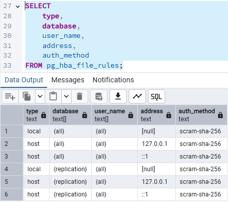

# Roles

Identificación solicitada
Reglas locales: 1 y 4 (socket Unix, address = null).
Reglas IPv4: 2 y 5, solo 127.0.0.1 (loopback).
Reglas IPv6: 3 y 6, solo ::1 (loopback).
Bases de datos afectadas: all (reglas 1 a 3) y replication (reglas 4 a 6; es una pseudo-base de datos para conexiones de replicación).
Usuarios afectados: all en todas las reglas.
Redes permitidas: únicamente loopback (127.0.0.1 y ::1) y el socket local. Ninguna red externa.
Método de autenticación: scram-sha-256 en las seis reglas.
Ninguna regla excesivamente amplia esta presente en este caso.
pg_hba.conf solo permite acceso local (socket, 127.0.0.1 y ::1) con scram-sha-256 y no contiene rangos como 0.0.0.0/0 o ::/0. Esto compensa en buena parte el listen_addresses = '*'. Falta aclarar la discrepancia con las conexiones desde 172.18.0.5 y restringir usuarios y bases de datos más allá de all.
