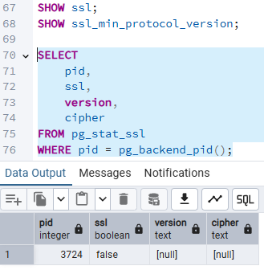

# Actividad 5 – Análisis de una regla permisiva

**Regla analizada (conceptual):**

```text
host    all    all    0.0.0.0/0    scram-sha-256
```

## Análisis de la regla

1. **Bases de datos permitidas:** `all`, todas las bases de datos del servidor, incluidas `postgres`, `template1` y las de cada alumno (`db_...`).
2. **Usuarios permitidos:** `all`, cualquier rol, incluido el superusuario `postgres`.
3. **Direcciones de origen:** `0.0.0.0/0`, cualquier dirección IPv4 del mundo (unos 4 mil millones de direcciones). Solo IPv4; para IPv6 el equivalente sería `::/0`.
4. **Método de autenticación:** `scram-sha-256`. Es el método más robusto disponible (la contraseña no viaja en claro ni se almacena como hash simple), pero es lo único que protege el acceso.
5. **Por qué es una exposición innecesaria:**
   - Cualquier host de Internet que alcance el puerto 5432 puede **intentar autenticarse**; la única barrera pasa a ser la contraseña.
   - Facilita **fuerza bruta, password spraying y credential stuffing**, incluso contra `postgres`.
   - Con `ssl = off`, el contenido de la sesión (consultas y datos) viaja **en texto claro**, aunque SCRAM proteja la contraseña. Con `listen_addresses = '*'`, la combinación deja el servicio expuesto.
   - Viola el **mínimo privilegio**: ningún cliente legítimo necesita acceso desde todo Internet.
   - Un error en el firewall o una vulnerabilidad en PostgreSQL pasa a ser explotable directamente.
6. **Información necesaria para restringirla:**
   - IP o rango de red de los clientes legítimos (p. ej. la `172.18.0.5` observada o su subred).
   - Qué base(s) de datos usa cada aplicación o usuario.
   - Qué roles se conectan de forma remota (y cuáles nunca deberían hacerlo, como `postgres`).
   - Si el cliente soporta SSL, para usar `hostssl`.
   - Topología de red y reglas de firewall actuales.
   - Confirmar con el responsable del servicio que el acceso es realmente necesario.

## Documentación

**Regla actual:**

```text
host    all    all    0.0.0.0/0    scram-sha-256
```

**Problema:**

Permite que cualquier usuario intente conectarse a cualquier base de datos desde cualquier IPv4 de Internet. La única defensa es la contraseña; no hay restricción de red, de usuario ni de base de datos, y sin SSL los datos viajan sin cifrar.

Solo el cliente legítimo identificado: por ejemplo `172.18.0.5/32` (o la subred privada `172.18.0.0/16` si hay varios clientes). *Confirmar con `pg_stat_activity` y con el responsable del servicio.*

**Base de datos:**

La base específica del cliente, por ejemplo `db_20443927_alejandro_ang…` (nombre completo según `pg_stat_activity`), en lugar de `all`.

**Usuario:**

El rol específico de ese cliente, por ejemplo `u_20443927_alejandro_ang…`, en lugar de `all`. Nunca `postgres`.

**Regla propuesta:**

(Solo propuesta, **no aplicada**.)

```text
hostssl    db_20443927_alejandro_ang…    u_20443927_alejandro_ang…    172.18.0.5/32    scram-sha-256
```

## Conclusión

La regla es una exposición innecesaria porque abre el servicio a todo Internet con solo la contraseña como defensa. Debe sustituirse por una regla que limite **origen (IP/32), base de datos, usuario y cifrado**, aplicando el principio de mínimo privilegio.

## Actividad 15 – Revisión de TLS



## Determinación

**¿La conexión actual utiliza TLS?**

**No.** `ssl = false`: la conexión de esta sesión viaja **sin cifrar**.

**Versión:**

`NULL` (no aplica, no hay sesión TLS).

**Cipher:**

`NULL` (no aplica, no hay sesión TLS).
