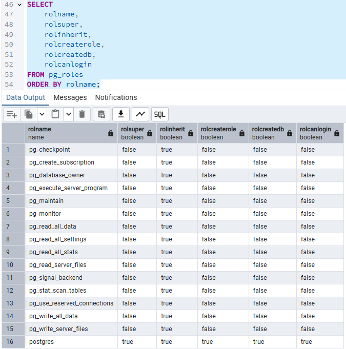
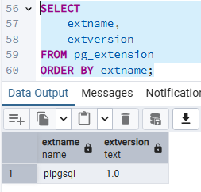
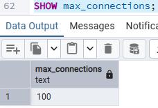
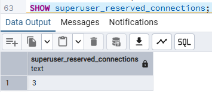
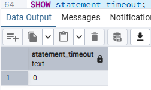
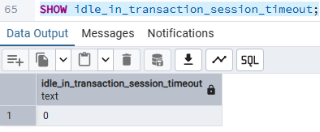

# Actividad 6 – Mínimo privilegio aplicado a conexiones

## Datos reales del laboratorio

Se toman de `pg_stat_activity`, donde se vio la única conexión remota (`client_addr` no nulo):

| Elemento | Valor observado |
| --- | --- |
| Origen | `172.18.0.5` |
| Usuario | `u_20443927_alejandro_ang…` |
| Base de datos | `db_20443927_alejandro_ang…` |
| Autenticación | `scram-sha-256` |

Para obtener los nombres completos:

```sql
SELECT DISTINCT usename, datname, client_addr
FROM pg_stat_activity
WHERE client_addr IS NOT NULL;
```

## Construcción de la regla

| Componente | Valor amplio (evitar) | Valor específico (propuesto) |
| --- | --- | --- |
| Tipo | `host` | `hostssl` (cuando SSL esté activo) |
| Base de datos | `all` | `db_20443927_alejandro_ang…` |
| Usuario | `all` | `u_20443927_alejandro_ang…` |
| Origen | `0.0.0.0/0` | `172.18.0.5/32` |
| Método | `trust`, `md5` | `scram-sha-256` |

## Regla propuesta

**Versión objetivo** (requiere `ssl = on`):

```text
hostssl    db_20443927_alejandro_ang…    u_20443927_alejandro_ang…    172.18.0.5/32    scram-sha-256
```

## Por qué es "tan específica como razonablemente posible"

- **`/32` en lugar de `/24` o `/16`:** autoriza un solo host. Si el contenedor cambia de IP (común en Docker al reiniciar), habría que ajustar la regla o usar una IP fija; en ese caso `172.18.0.0/16` es un compromiso aceptable, pero menos estricto.
- **Un usuario y una base de datos:** si esa cuenta se compromete, el atacante solo llega a su propia base, no a las de otros alumnos ni a `postgres`.
- **Sin regla para `postgres` remoto:** el superusuario solo debe conectarse por local/loopback, que ya está cubierto por las reglas existentes.
- **Denegación por defecto:** lo que no coincide con ninguna regla es rechazado, así que no hace falta una regla de rechazo explícita.

## Consideraciones antes de aplicarla

1. **El orden importa.** PostgreSQL usa la **primera regla que coincide**; la nueva debe ir antes de cualquier regla más general.
1. **Incongruencia pendiente.** El resultado de `pg_hba_file_rules` solo mostraba reglas locales y loopback, y aun así existen sesiones desde `172.18.0.5`. Antes de modificar, revisa la columna `error` y confirma que consultas la instancia correcta.
1. **Respaldo previo** de `C:/Program Files/PostgreSQL/17/data/pg_hba.conf`.
1. **Aplicar con recarga**, sin reiniciar:

```sql
SELECT pg_reload_conf();
```

1. **Verificar** el resultado:

```sql
SELECT line_number, type, database, user_name, address, auth_method, error
FROM pg_hba_file_rules;
```

1. **Probar** que el cliente legítimo sigue conectando y que otro origen o usuario es rechazado.

## Conclusión sobre acceso mínimo

La regla restringe base de datos, usuario, origen y método de autenticación a lo estrictamente necesario: el cliente `172.18.0.5` con su propio usuario y su propia base, autenticado con `scram-sha-256`. Reduce la exposición de "cualquier host y cualquier cuenta" a "un host y una cuenta".

## Análisis de roles



### Identificación solicitada

- **Superusuarios:** solo `postgres` (en lo visible).
- **Usuarios que pueden iniciar sesión:** solo `postgres` (en lo visible). Los roles `pg_*` tienen `LOGIN = false`, lo cual es correcto: son contenedores de privilegios, no cuentas.
- **Con CREATEROLE:** solo `postgres`.
- **Con CREATEDB:** solo `postgres`.
- **Roles utilizados por aplicaciones:** ninguno entre los visibles. Los que usan aplicaciones y clientes son los `u_...`, que faltan en la captura. Por `pg_stat_activity`, `u_20443927_alejandro_ang…` se conecta desde `172.18.0.5` y varios `u_<matrícula>_...` usan pgAdmin.
- **Cuentas que podrían ser innecesarias:**
  - Ninguno de los 15 roles `pg_*` es una cuenta que deba eliminarse: son parte del sistema y no pueden iniciar sesión. Lo importante es **revisar a quién se le han concedido** los más sensibles (`pg_execute_server_program`, `pg_read_server_files`, `pg_write_server_files`, `pg_write_all_data`, `pg_read_all_data`), porque equivalen a casi un superusuario.
  - Entre los `u_...` (no visibles aún): cuentas de alumnos sin sesiones activas, sin base de datos asignada o ajenas al laboratorio actual, además de cualquiera con `SUPERUSER`, `CREATEROLE` o `CREATEDB` sin justificación.

### Hallazgos de seguridad

1. **`postgres` concentra todos los privilegios.** Es esperable, pero debe usarse solo para administración, con contraseña robusta, sin acceso remoto (confirmado en `pg_hba.conf`: solo local y loopback) y no como cuenta de aplicaciones.
2. **El único superusuario con login es `postgres`** (dentro de lo visible): buena práctica, sin superusuarios adicionales.
3. **Los roles predefinidos están bien configurados:** ninguno puede iniciar sesión ni tiene atributos elevados.
4. **Queda pendiente auditar los roles `u_...`** para verificar que no tengan atributos elevados innecesarios.

### Consultas para completar el análisis

Roles de los alumnos (los que faltan en la captura):

```sql
SELECT rolname, rolsuper, rolcreaterole, rolcreatedb, rolcanlogin
FROM pg_roles
WHERE rolname NOT LIKE 'pg\_%'
ORDER BY rolname;
```

Roles con privilegios elevados que pueden iniciar sesión:

```sql
SELECT rolname
FROM pg_roles
WHERE rolcanlogin
  AND (rolsuper OR rolcreaterole OR rolcreatedb);
```

Quién pertenece a los roles predefinidos sensibles:

```sql
SELECT r.rolname AS rol, m.rolname AS miembro
FROM pg_auth_members am
JOIN pg_roles r ON r.oid = am.roleid
JOIN pg_roles m ON m.oid = am.member
WHERE r.rolname LIKE 'pg\_%'
ORDER BY r.rolname, m.rolname;
```

Roles sin sesiones activas (candidatos a innecesarios):

```sql
SELECT r.rolname
FROM pg_roles r
LEFT JOIN pg_stat_activity a ON a.usename = r.rolname
WHERE r.rolcanlogin AND a.pid IS NULL;
```

## Conclusión sobre roles

En lo visible, el modelo de roles es sano: solo `postgres` es superusuario y puede iniciar sesión, y los roles predefinidos `pg_*` no tienen login ni atributos elevados. El análisis queda **incompleto** hasta revisar los roles `u_...` de los alumnos, que son los que usan las aplicaciones y los clientes, y confirmar que ninguno tenga `SUPERUSER`, `CREATEROLE` o `CREATEDB` sin justificación.

## Actividad 10 – Revisión de extensiones



La consulta devuelve **una sola extensión**: `plpgsql`. Es importante recordar que `pg_extension` muestra las extensiones instaladas **en la base de datos a la que estás conectado**, no en todo el servidor. Cada base (`db_...`) puede tener las suyas.

### 1. ¿Qué extensiones existen?

Solo `plpgsql` v1.0, el lenguaje procedural estándar de PostgreSQL.

### 2. ¿Cuáles son necesarias?

`plpgsql` es necesaria: viene instalada por defecto en toda base de datos, muchas funciones, triggers y procedimientos dependen de ella, y no representa un riesgo significativo. No debe eliminarse.

### 3. ¿Cuáles fueron instaladas para prácticas?

Ninguna. No aparecen extensiones adicionales como `pgcrypto`, `pg_stat_statements`, `uuid-ossp` o `postgis`, que suelen instalarse en laboratorios.

### 4. ¿Cuáles podrían representar funcionalidad innecesaria en otro entorno?

En esta base, ninguna. Como referencia general, en otros entornos conviene revisar con cuidado:

## Límites de conexión y tiempos de espera – PostgreSQL 17






### Función de cada parámetro

#### `max_connections` = 100

Número máximo de conexiones simultáneas que acepta el servidor. Cada conexión consume un proceso del sistema operativo y memoria (`work_mem`, buffers, etc.). Al alcanzar el límite, las nuevas conexiones son rechazadas con el error `too many clients already`. Requiere **reinicio** del servicio para cambiarse.

#### `superuser_reserved_connections` = 3

Número de conexiones que se reservan **solo para superusuarios** (y roles con `pg_use_reserved_connections`, que tiene ese privilegio en PG 16+). Se descuentan del total: los usuarios normales pueden usar efectivamente `100 - 3 = 97` conexiones. Garantiza que un administrador pueda entrar a diagnosticar aunque el servidor esté saturado. Requiere **reinicio**.

#### `statement_timeout` = 0

Tiempo máximo que puede ejecutarse una sentencia antes de ser cancelada automáticamente. El valor `0` significa **sin límite**: una consulta mal escrita o maliciosa puede ejecutarse indefinidamente. Se puede cambiar con recarga, por rol o por base de datos.

#### `idle_in_transaction_session_timeout` = 0

Cierra automáticamente las sesiones que llevan demasiado tiempo **dentro de una transacción abierta sin ejecutar nada** (estado `idle in transaction`). El valor `0` significa **sin límite**: una transacción olvidada puede quedar abierta por horas o días. Se puede cambiar con recarga, por rol o por base de datos.

### Pregunta: ¿Por qué mantener conexiones indefinidamente abiertas puede representar un problema de disponibilidad o consumo de recursos?

1. **Cada conexión consume recursos.** PostgreSQL crea un proceso por conexión, con memoria propia y un lugar en las tablas internas. Muchas conexiones inactivas ocupan RAM y CPU sin aportar trabajo útil.
2. **El límite es finito.** Con `max_connections = 100`, conexiones abandonadas o inactivas ocupan cupos. Al llenarse, los usuarios legítimos reciben `too many clients already` y el servicio queda **no disponible** aunque el servidor esté "sano". Solo quedan las 3 conexiones reservadas para superusuarios.
3. **Las transacciones abiertas retienen bloqueos.** Una sesión `idle in transaction` puede mantener bloqueos sobre tablas o filas, haciendo que otras sesiones queden esperando indefinidamente (bloqueos en cadena).
4. **Impiden la limpieza (`VACUUM`).** Una transacción antigua mantiene visibles versiones viejas de filas, por lo que el autovacuum no puede limpiarlas. Esto provoca **bloat** (hinchazón de tablas e índices), degradación del rendimiento y mayor uso de disco.
5. **Facilitan ataques de denegación de servicio (DoS).** Un atacante, o simplemente una aplicación mal programada, puede abrir conexiones y dejarlas ociosas hasta agotar el límite, o lanzar consultas pesadas sin que `statement_timeout` las corte.
6. **Dificultan la detección de problemas.** Sesiones olvidadas generan ruido en la auditoría y ocultan actividad sospechosa.

## Actividad 14 – Diseño de una política de firewall (conceptual)

### Escenario

| Elemento | Valor |
| --- | --- |
| Servidor PostgreSQL | `10.10.10.20` |
| Puerto | `5432/TCP` |
| Red autorizada (DBA) | `10.10.10.0/24` |

### Política propuesta

| # | Origen | Destino | Puerto | Acción |
| --- | --- | --- | --- | --- |
| 1 | `10.10.10.0/24` | PostgreSQL (`10.10.10.20`) | 5432/TCP | **Permitir** |
| 2 | Cualquier otro origen | PostgreSQL (`10.10.10.20`) | 5432/TCP | **Denegar** |

- **El orden importa:** el firewall evalúa las reglas de arriba hacia abajo y aplica la primera que coincide. La regla de permitir debe ir antes que la de denegar.
- **Registro (logging):** conviene registrar los paquetes denegados hacia el puerto 5432, para detectar escaneos e intentos de acceso no autorizado.
- **Mínimo privilegio:** si solo ciertos equipos DBA necesitan acceso, se puede reducir `10.10.10.0/24` a las IP específicas (`/32`) de esos equipos.

### Pregunta: ¿Por qué `pg_hba.conf` y el firewall no son controles equivalentes?

Ambos controlan quién se conecta, pero actúan en **capas distintas**, con información y alcance diferentes. Por eso son **complementarios**, no intercambiables.

#### Aplicado a esta política

| Control | Qué hace en este diseño |
| --- | --- |
| Firewall | Solo `10.10.10.0/24` llega al puerto 5432 de `10.10.10.20` |
| `pg_hba.conf` | Solo ciertos usuarios, a ciertas bases, desde esa red, con `scram-sha-256` |
| `listen_addresses` | Escucha solo en `localhost` y `10.10.10.20`, no en `*` |
| SSL/TLS | Cifra el tráfico dentro de la red permitida |

El firewall decide **quién puede llegar** al servicio; `pg_hba.conf` decide **quién puede entrar** una vez que llegó. Uno filtra la red y el otro la identidad y el acceso lógico, por lo que ninguno reemplaza al otro. La seguridad adecuada exige ambos, junto con `listen_addresses` restringido y SSL/TLS.
